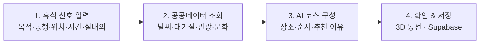
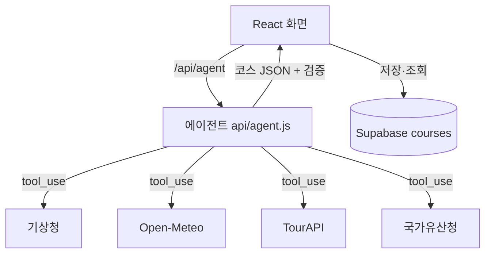

<div align="center">

# 🌿 JEJU WELLNESS CONCIERGE

**제주 웰니스 경험을 설계하는 AI 컨시어지**

*Wellness Expertise × Jeju Open Data × AI Agent*


**[📦 GitHub](https://github.com/jeongeunlee0)**

</div>

---

## ✨ 한 줄 소개

웰니스 전문가의 경험 설계 노하우를 제주 공공데이터와 AI 에이전트로 구현한, 개인 맞춤형 웰니스 컨시어지 서비스입니다.

> **“지금 나에게 어떤 휴식이 필요한가?”** 에서 출발해 장소·동선·소요 시간과 **추천 이유**까지 함께 제안합니다.

## 🎯 왜 만들었나

제주 관광 정보는 많지만, 개인의 상황에 맞는 휴식을 고르고 이어 붙이기는 어렵습니다.

| 일반적인 장소 추천 | JEJU WELLNESS CONCIERGE |
|---|---|
| 장소 검색 중심 | **휴식 목적** 중심 |
| 개별 관광지 추천 | **연결된 웰니스 코스** 제안 |
| 인기·평점 중심 | **개인의 선호와 상황** 반영 |
| 정보 나열 | **추천 이유** 설명 |

## 🧭 사용자 여정



## 🧩 주요 기능

| 기능 | 설명 |
|---|---|
| 🎛 **휴식 선호 입력** | 휴식 목적 · 동행 · 위치 · 이용 시간 · 실내/실외 선호 · 추가 요청 |
| 🤖 **AI 컨시어지 (에이전트)** | LLM이 스스로 도구를 골라 호출(날씨 → 대기질 → 장소 검색)하고 코스를 설계 |
| ✅ **근거 표시** | 호출한 도구 목록·조회 시점 표시, 추천 장소가 API 결과에 실제 있는지 **서버에서 대조(`API 확인` 뱃지)** |
| 🏝 **3D 동선 지도** | Three.js로 제주 지형을 그리고 추천 코스를 순서대로 핀·점선으로 표시 |
| 💾 **코스 저장** | 닉네임 기준으로 Supabase에 저장·조회 (새로고침해도 유지) |
| 🌤 **오늘의 컨디션** | 기상청 날씨 + 미세먼지·자외선을 한 줄로 |

### 추천 판단 기준

| 기준 | 확인하는 내용 |
|---|---|
| 휴식 목적 | 사용자가 원하는 경험 |
| 환경 | 날씨·대기질과 실내/실외 선호 |
| 편의성 | 이용 가능 시간 안에 들어오는 장소 수(2~4곳) |
| 경험의 흐름 | 진정 → 이완 → 회복 → 마무리 순서 |
| 정보 신뢰성 | 데이터 출처·조회 시점·API 확인 여부 |

> ⚠️ 사용자의 상태는 휴식 선호를 파악하는 정보로만 쓰며, **의료적 진단이나 치료 효과를 제시하지 않습니다.**

## 🔌 사용한 공공데이터 API (4개)

| API | 용도 | 키 |
|---|---|---|
| 기상청 단기예보 (`VilageFcstInfoService_2.0`) | 기온·하늘·강수확률 → 실내/실외 판단 | 공공데이터포털 |
| 한국관광공사 TourAPI (`KorService2`) | 스파·숲·해변·카페 등 웰니스 장소 검색 | 공공데이터포털 |
| 국가유산청 국가유산 검색 | 조용히 거닐며 문화를 느끼는 코스 재료 | 불필요 |
| Open-Meteo 대기질 | 미세먼지(PM10/PM2.5)·자외선 지수 → 야외 활동 판단 | 불필요 |

## 🏗 구조

```
api/        Vercel 서버 함수 (/api/파일이름) — 비밀 키는 여기서만
  agent.js    AI 에이전트: 도구 4개를 골라 호출 → JSON 코스 → 장소 검증
server/     공공데이터 호출 함수 (api/ 와 에이전트가 함께 사용)
src/
  router.jsx          메뉴 + 주소별 페이지
  store/              Zustand 전역 상태 (선호·결과·저장 코스·알림)
  api/client.js       화면 → /api 호출
  components/         ItemCard · ConditionsBar · CourseResult · Jeju3D …
  pages/              Home · Concierge · Places · Heritage · My
supabase/schema.sql   courses 테이블
```



## 🚀 실행 방법

```bash
npm install
cp .env.example .env.local     # 값 채우기
npm run dev                    # http://localhost:5173  (화면 + /api 함께 동작)
```

`.env.local`

| 변수 | 설명 |
|---|---|
| `VITE_SUPABASE_URL`, `VITE_SUPABASE_ANON_KEY` | Supabase (브라우저용 공개 키) |
| `DATA_GO_KR_KEY` | 공공데이터포털 **Decoding** 키 (서버 전용) |
| `ANTHROPIC_API_KEY` | Claude 키 (서버 전용 — 절대 GitHub에 올리지 않기) |

1. Supabase SQL Editor 에서 [`supabase/schema.sql`](supabase/schema.sql) 실행
2. 홈 화면 **동작 체크** 카드가 모두 초록이 되는지 확인
3. 키가 없어도 홈·국가유산·대기질·3D는 동작하고, 코스 저장은 브라우저(localStorage)에 임시 저장됩니다

## ☁️ 배포 (Vercel)

1. GitHub에 push → Vercel에서 저장소 Import (Framework: Vite)
2. **Settings → Environment Variables** 에 위 4개 변수 입력 후 Redeploy
3. `vercel.json` 의 rewrites 가 새로고침 404 를 막아 줍니다

## 🔒 보안

- 비밀 키(`DATA_GO_KR_KEY`, `ANTHROPIC_API_KEY`)는 `/api` 서버 함수에서만 사용, 브라우저로 내려가지 않음
- `.env.local` 은 `.gitignore` 로 제외 (`*.local`)
- 로그인 없는 MVP이므로 Supabase RLS 는 데모용 공개 정책 — **실서비스 전 로그인 기반 정책으로 교체 필요**

## 🧪 검증 체크리스트

- [ ] 조건(목적·시간·실내외)이 코스에 반영되는가
- [ ] 비 오는 날 / 미세먼지 나쁨일 때 실내 중심으로 바뀌는가
- [ ] 도구 목록과 조회 시점이 화면에 보이는가
- [ ] 도구 결과에 없는 장소가 `확인 필요`로 표시되는가
- [ ] 저장 후 새로고침해도 목록이 남는가
- [ ] API 오류·키 없음 상태에서 앱이 멈추지 않는가

## 🗺 MVP 범위

**포함** 선호 입력 · API 4종 · AI 코스·추천 이유 · Supabase 저장 · 3D 동선 · Vercel 배포
**제외** 예약 · 결제 · 로그인 · 관리자 페이지 (이동 시간·시설 이용 가능 여부는 확보한 데이터 범위 내에서만 안내)

## 👤 만든 사람

럭셔리 호텔 스파 Head Therapist · 오프닝 · 고객 경험 설계 경험을 바탕으로, 웰니스 전문가의 판단 기준을 데이터와 AI로 옮기는 서비스를 만듭니다.
제주대 청년도약 부트캠프 1기 · 개인 프로젝트

---

<sub>데이터 출처: 기상청 · 한국관광공사 · 국가유산청 · Open-Meteo</sub>
