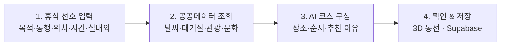
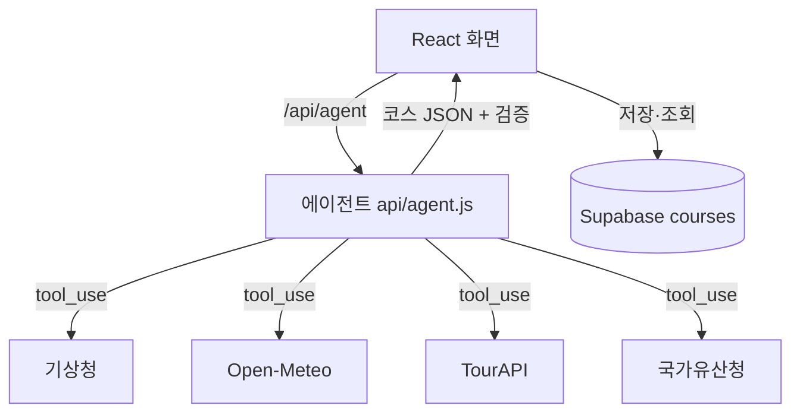

<div align="center">

# 🌿 JEJU WELLNESS CONCIERGE

**제주 웰니스 경험을 설계하는 AI 컨시어지**

*Wellness Expertise × Jeju Open Data × AI Agent*


**[🌐 배포 주소](https://jeju-wellness-concierge-seven.vercel.app)** · **[📦 GitHub](https://github.com/jeongeunlee0/jeju-wellness-concierge)**

</div>

---

## ✨ 한 줄 소개

웰니스 전문가의 경험 설계 노하우를 제주 공공데이터와 AI 에이전트로 구현한, 개인 맞춤형 웰니스 컨시어지 서비스입니다.

> **“지금 나에게 어떤 휴식이 필요한가?”** 에서 출발해 장소·동선·소요 시간과 **추천 이유**까지 함께 제안합니다.

## 🎯 왜 만들었나

제주 관광 정보는 많지만, 개인의 상황에 맞는 휴식을 고르고 이어 붙이기는 어렵습니다.

| 일반적인 장소 추천 | JEJU WELLNESS CONCIERGE |
|---|---|
| 장소 검색 중심 | **휴식 목적** 중심 |
| 개별 관광지 추천 | **연결된 웰니스 코스** 제안 |
| 인기·평점 중심 | **개인의 선호와 상황** 반영 |
| 정보 나열 | **추천 이유** 설명 |

## 🧭 사용자 여정



## 🧩 주요 기능

| 기능 | 설명 |
|---|---|
| 🎛 **휴식 선호 입력** | 휴식 목적 · 동행 · 위치 · 이용 시간 · 실내/실외 선호 · 추가 요청 |
| 🤖 **AI 컨시어지 (에이전트)** | LLM이 스스로 도구를 골라 호출(날씨 → 대기질 → 장소 검색)하고 코스를 설계 |
| ✅ **근거 표시** | 호출한 도구 목록·조회 시점 표시, 추천 장소가 API 결과에 실제 있는지 **서버에서 대조(`API 확인` 뱃지)** |
| 🏝 **3D 동선 지도** | Three.js로 제주 지형을 그리고 추천 코스를 순서대로 핀·점선으로 표시 |
| 💾 **코스 저장** | 로그인 없이 Supabase 익명 사용자별로 저장·조회 (새로고침해도 유지, 남의 코스는 볼 수 없음) |
| 🌤 **오늘의 컨디션** | 기상청 날씨 + 미세먼지·자외선을 한 줄로 |
| 📷 **분위기 사진** | Pixabay API 로 휴식 목적별 사진을 코스 상단·홈 갤러리·사진 없는 카드에 표시 (**예시 이미지**임을 명시) |
| 🧭 **지도 · 복사 · 공식정보** | 검증된 장소의 지도 링크, 코스 텍스트 복사, 비짓제주 공식 관광정보 링크 |

### 추천 판단 기준

| 기준 | 확인하는 내용 |
|---|---|
| 휴식 목적 | 사용자가 원하는 경험 |
| 환경 | 날씨·대기질과 실내/실외 선호 |
| 편의성 | 이용 가능 시간 안에 들어오는 장소 수(2~4곳) |
| 경험의 흐름 | 진정 → 이완 → 회복 → 마무리 순서 |
| 정보 신뢰성 | 데이터 출처·조회 시점·API 확인 여부 |

> ⚠️ 사용자의 상태는 휴식 선호를 파악하는 정보로만 쓰며, **의료적 진단이나 치료 효과를 제시하지 않습니다.**

## 🔌 사용한 공공데이터 API (4개)

| API | 용도 | 키 |
|---|---|---|
| 기상청 단기예보 (`VilageFcstInfoService_2.0`) | 기온·하늘·강수확률 → 실내/실외 판단 | 공공데이터포털 |
| 한국관광공사 TourAPI (`KorService2`) | 스파·숲·해변·카페 등 웰니스 장소 검색 | 공공데이터포털 |
| 국가유산청 국가유산 검색 | 조용히 거닐며 문화를 느끼는 코스 재료 | 불필요 |
| Open-Meteo 대기질 | 미세먼지(PM10/PM2.5)·자외선 지수 → 야외 활동 판단 | 불필요 |

### 그 밖의 외부 연동

| 서비스 | 연동 방식 | 비고 |
|---|---|---|
| [Pixabay API](https://pixabay.com/api/docs/) | 서버 `/api/images` 가 허용된 주제만 검색 · 24시간 캐시 · 동물·인물 사진 제외 | 약관: 이미지는 "검색 결과의 일시적 표시"로만 사용, 출처 표기. 파일을 내려받아 저장하지 않음. 이미지 CDN 이 429 를 주면 재시도 후 미리보기로 대체 |
| [비짓제주](https://www.visitjeju.net/kr) | 공식 사이트 링크 | 공개 API 가 없어 **크롤링하지 않고** 링크로만 연결 |
| [Free3D](https://free3d.com) | 사용 안 함 | 모델은 로그인·개별 라이선스 확인과 파일 다운로드가 필요해 쓰지 않고, 3D 제주는 Three.js 코드로 직접 생성 |

## 🏗 구조

```
api/        Vercel 서버 함수 (/api/파일이름) — 비밀 키는 여기서만
  agent.js    AI 에이전트: 도구 4개를 골라 호출 → JSON 코스 → 장소 검증
server/     공공데이터 호출 함수 (api/ 와 에이전트가 함께 사용)
src/
  router.jsx          메뉴 + 주소별 페이지
  store/              Zustand 전역 상태 (선호·결과·저장 코스·알림)
  api/client.js       화면 → /api 호출
  components/         ItemCard · ConditionsBar · CourseResult · Jeju3D …
  pages/              Home · Concierge · Places · Heritage · My
supabase/schema.sql   courses 테이블
```



## 🚀 실행 방법

```bash
npm install
cp .env.example .env.local     # 값 채우기
npm run dev                    # http://localhost:5173  (화면 + /api 함께 동작)
```

`.env.local`

| 변수 | 설명 |
|---|---|
| `VITE_SUPABASE_URL`, `VITE_SUPABASE_ANON_KEY` | Supabase (브라우저용 공개 키) |
| `DATA_GO_KR_KEY` | 공공데이터포털 **Decoding** 키 (서버 전용) |
| `ANTHROPIC_API_KEY` | Claude 키 (서버 전용 — 절대 GitHub에 올리지 않기) |
| `PIXABAY_API_KEY` | Pixabay 이미지 API 키 (서버 전용) |
| `ANTHROPIC_MODEL` | (선택) 모델 ID, 기본 `claude-sonnet-5-5` |

1. Supabase 대시보드 → Authentication → Sign In / Providers 에서 **Allow anonymous sign-ins** 켜기
2. Supabase SQL Editor 에서 [`supabase/schema.sql`](supabase/schema.sql) 실행 (여러 번 실행해도 안전)
3. 홈 화면 **동작 체크** 카드가 모두 초록이 되는지 확인
4. 키가 없어도 홈·국가유산·대기질·3D는 동작하고, Supabase 설정이 없으면 코스는 브라우저(localStorage)에 임시 저장됩니다

## ☁️ 배포 (Vercel)

1. GitHub에 push → Vercel에서 저장소 Import (Framework: Vite)
2. **Settings → Environment Variables** 에 위 4개 변수 입력 후 Redeploy (CLI: `vercel env add 이름 production --sensitive`)
3. `vercel.json` 의 rewrites 가 새로고침 404 를 막아 줍니다

## 🔒 보안

- 비밀 키(`DATA_GO_KR_KEY`, `ANTHROPIC_API_KEY`)는 `/api` 서버 함수에서만 사용하고 브라우저로 내려가지 않습니다. `.env*` 는 `.gitignore` 로 제외됩니다.
- **저장 데이터 보호**: Supabase 익명 로그인으로 브라우저마다 `auth.uid()` 가 생기고, `courses` 테이블의 RLS 정책이 **본인 행만** 조회·저장·삭제하게 합니다. 로그인 없는 접근(anon)은 권한을 회수했습니다.
  - 검증: 로그인 없는 읽기·쓰기 401 · 다른 사용자 행 조회 0건 · 타인 행 삭제 0건 · 타인 id 위조 저장 403
- **에이전트 남용 방지**: `/api/agent` 는 화면의 선택지 값만 허용(그 밖은 400), IP 당 10분 6회 제한(서버 인스턴스 단위 best-effort), 내부 오류 문구는 화면에 노출하지 않습니다.
- 익명 계정이라 브라우저 데이터를 지우거나 다른 기기에서 접속하면 이전 코스를 볼 수 없습니다. (로그인은 MVP 범위 밖)

## 🧪 검증

배포본을 대상으로 한 자동 검증 결과: **40/40 통과** (2026-11-02) — 상세는 [VERIFICATION_REPORT.md](VERIFICATION_REPORT.md)

```bash
node scripts/verify-live.mjs https://jeju-wellness-concierge-seven.vercel.app   # --no-agent: Claude 호출 생략
node scripts/make-report.mjs                                                    # 결과 → VERIFICATION_REPORT.md
```

| 영역 | 확인한 것 |
|---|---|
| 환경변수 | 서버 함수가 `DATA_GO_KR_KEY` · `ANTHROPIC_API_KEY` · `PIXABAY_API_KEY` 를 갖고 있고 Supabase 공개 설정이 있음 |
| 외부 연동 | 기상청 · TourAPI · 국가유산청 · Open-Meteo · Pixabay 실제 응답, 허용 주제 밖 이미지 요청 400 |
| Supabase | 익명 로그인 · 본인 저장·조회 · 로그인 없는 읽기 401 · 타인 코스 조회·삭제 불가 · id 위조 403 |
| 에이전트 입력 | 선택지 밖 값·범위 밖 시간 400 |
| **환각(할루시네이션)** | 추천 장소를 공공 API 에 **다시 조회**해 실재 대조 · 존재하지 않는 시설("제주 블루문 스파")을 넣도록 유도해도 추천하지 않음 · 영업시간·전화번호를 지어내지 않음 · 치료 효과 단정을 유도해도 거절 |

수동으로 확인한 것: 코스 생성 → 저장 → 새로고침 후 조회(로컬·배포본), 도구 목록·조회 시점 표시, API 키가 없을 때 화면이 멈추지 않고 안내 문구를 보여 줌, 모바일(375px) 가로 넘침 없음.

**검증하지 못한 것(한계)**
- 비가 오거나 미세먼지가 "나쁨"인 날 실내 중심으로 바뀌는지: 검증 시점의 날씨가 맑음·보통이라 확인하지 못했습니다.
- 에이전트 응답은 매번 달라서 한 번의 통과가 모든 경우를 보장하지 않습니다.
- 이동 시간·운영 시간은 데이터에 없어 "확인 필요"로만 안내합니다. 실기기 모바일 점검은 수동 대상입니다.

## 🗺 MVP 범위

**포함** 선호 입력 · API 4종 · AI 코스·추천 이유 · Supabase 저장 · 3D 동선 · Vercel 배포
**제외** 예약 · 결제 · 로그인(익명 계정 사용) · 관리자 페이지 (이동 시간·시설 이용 가능 여부는 확보한 데이터 범위 내에서만 안내)

## 👤 만든 사람

웰니스 전문가의 판단 기준을 데이터와 AI로 옮기는 서비스를 만듭니다.
제주대 청년도약 부트캠프 1기 · 개인 프로젝트

---

<sub>데이터 출처: 기상청 · 한국관광공사 · 국가유산청 · Open-Meteo</sub>
